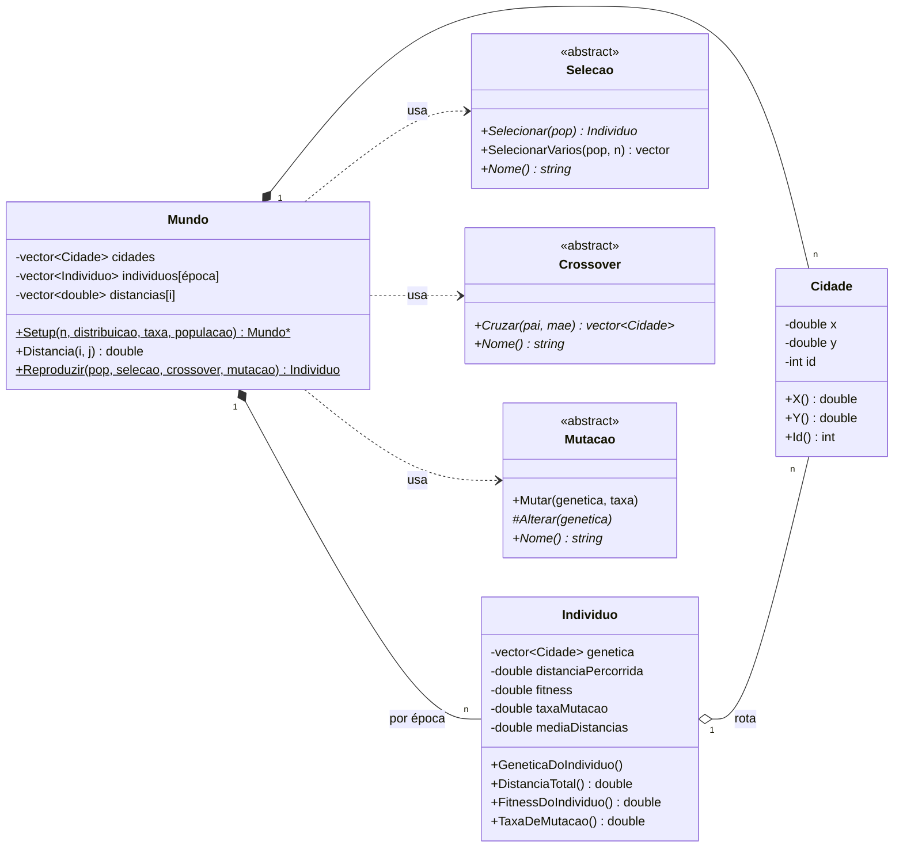
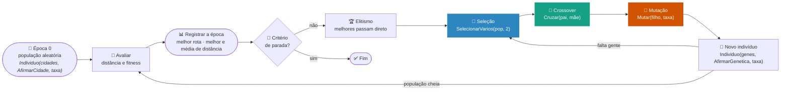

# Caixeiro viajante com algoritmo genético

## Interface gráfica em Python

A interface usa Tkinter para os controles e Matplotlib para os gráficos. Ela
permite preencher e salvar os parâmetros em JSON, carregar os CSVs produzidos
pelo programa C++ e visualizar a evolução das distâncias e a melhor rota.

No Ubuntu/Debian, instale o suporte do Tkinter e ambientes virtuais, crie um
ambiente Python local e instale o Matplotlib:

```bash
sudo apt install python3-tk python3-venv
python3 -m venv .venv
source .venv/bin/activate
python -m pip install -r requirements.txt
python3 interface.py
```

Para visualizar resultados, escolha a pasta que contém:

- `historico.csv`: colunas `epoca,melhor_distancia,distancia_media,melhor_rota`;
- `cidades.csv`: colunas `indice,x,y`.

`melhor_rota` deve conter os índices das cidades separados por espaços, por
exemplo `0 3 1 2`. O algoritmo C++ ainda precisa ser ligado à interface para
ler a configuração JSON e gerar esses arquivos.

<div align="center">

# 🧬 Genéticos · Caixeiro Viajante

**Um algoritmo genético em C++ para encontrar rotas curtas que passam por todas as cidades e voltam ao início.**

Seleção, crossover e mutação são peças trocáveis: 5 × 4 × 3 = **60 combinações** para descobrir qual evolui melhor nos cenários uniforme e circular.

<br />


<br />


</div>

---

## Visão geral

O **Problema do Caixeiro Viajante** (TSP) pede o caminho mais curto que visita cada cidade uma única vez e volta ao ponto de partida. Com *n* cidades existem *(n−1)!/2* rotas diferentes. Com 20 cidades isso já passa de 6 × 10¹⁶, então testar todas não é uma opção.

Este projeto ataca o problema com um **algoritmo genético**: uma população de rotas evolui ao longo das épocas, e as melhores rotas têm mais chance de passar adiante os seus trechos.

> 🎓 Trabalho em grupo da disciplina (**Genéticos**, até 4 pessoas). O objetivo não é só resolver, mas **explicar e comparar** as escolhas: população, parada, mutação, representação, cruzamento e aptidão.

### ✨ O que já existe

| | Peça | Em uma frase |
|:-:|---|---|
| 🏙️ | **Cidades** | Pontos 2D gerados em dois cenários: **uniforme** no quadrado [0, 1)² ou **circular** no círculo unitário. |
| 📏 | **Matriz de distâncias** | Distância euclidiana entre todos os pares, calculada uma vez e guardada só no triângulo superior. |
| 🧬 | **Indivíduo** | Uma rota: a ordem em que as cidades são visitadas. A população inicial é embaralhada aleatoriamente. |
| 🎯 | **5 seleções** | Torneio, Roleta, Ranking, Top Ranking e Amostragem Estocástica Universal. |
| 🔀 | **4 crossovers** | OX, PMX, ERX e Uniforme, todos adaptados para nunca repetir nem perder cidades. |
| 🎲 | **3 mutações** | Inversão (2-opt), Inserção e Troca. |
| 👶 | **Reprodução** | `Mundo::Reproduzir` combina qualquer seleção, crossover e mutação para gerar um filho. |

---

## Sumário

- [Visão geral](#visão-geral)
- [O problema](#-o-problema)
- [Arquitetura](#arquitetura)
- [Representação do gene](#representação-do-gene)
- [Operadores genéticos](#operadores-genéticos)
  - [Seleção](#-seleção)
  - [Crossover](#-crossover)
  - [Mutação](#-mutação)
- [Uma época, passo a passo](#uma-época-passo-a-passo)
- [Decisões de projeto](#decisões-de-projeto)
- [Mapa da avaliação](#mapa-da-avaliação)
- [Estrutura do repositório](#estrutura-do-repositório)
- [Como usar](#como-usar)
- [Pendências e limitações](#pendências-e-limitações)
- [Equipe](#equipe)

---

## 🗺️ O problema

| Regra do enunciado | Como está no código |
|---|---|
| Pontos em duas dimensões | `Cidade` com `X()`, `Y()` e `Id()` |
| Caminho **cíclico** passando por todos os pontos | A rota é uma permutação das cidades; a última liga de volta à primeira |
| Minimizar a distância **euclidiana** | `Mundo::Distancia(i, j)` = √(Δx² + Δy²) |
| Quantidade arbitrária, **ao menos 8** | `Mundo::Setup` recusa menos de 8 cidades |
| Cenário 1: **uniformemente distribuídos** | `DistribuicaoCidades::Uniforme` |
| Cenário 2: **círculo de pontos** (benchmark) | `DistribuicaoCidades::Circular` |

### 🎯 Por que o círculo é o benchmark

No círculo, a **rota ótima é conhecida**: é o próprio polígono, visitando as cidades na ordem do ângulo. Com *n* cidades igualmente espaçadas no círculo de raio 1:

$$
D^{*}(n) = 2\,n\,\sin\!\left(\frac{\pi}{n}\right) \xrightarrow{\;n\to\infty\;} 2\pi \approx 6{,}2832
$$

| *n* | 8 | 50 | 100 | 1000 |
|---|:-:|:-:|:-:|:-:|
| **D\*** | 6,1229 | 6,2791 | 6,2822 | 6,2832 |

Assim, dá para medir **quão longe do ótimo** o algoritmo está em cada época: `erro = (melhor distância − D*) / D*`.

---

## Arquitetura

### 🧱 Classes



### 🧩 Hierarquia dos operadores

```mermaid
flowchart TB
    S{{"🎯 Selecao"}}
    S --> S1["SelecaoTorneio(k)"]
    S --> S2["SelecaoRoleta"]
    S --> S3["SelecaoRanking"]
    S --> S4["SelecaoTopRanking(fração)"]
    S --> S5["SelecaoAmostragemEstocastica"]

    C{{"🔀 Crossover"}}
    C --> C1["CrossoverOX"]
    C --> C2["CrossoverPMX"]
    C --> C3["CrossoverERX"]
    C --> C4["CrossoverUniforme"]

    M{{"🎲 Mutacao"}}
    M --> M1["MutacaoInversao"]
    M --> M2["MutacaoInsercao"]
    M --> M3["MutacaoTroca"]

    style S fill:#2E86C1,color:#fff,stroke:none
    style C fill:#16A085,color:#fff,stroke:none
    style M fill:#D35400,color:#fff,stroke:none
```



Cada operador herda de uma **classe base abstrata**. `Mundo::Reproduzir` só conhece as bases, então trocar de estratégia é passar outro objeto. É isso que permite comparar as 60 combinações sem duplicar código.

### 📏 Matriz de distâncias triangular

A distância de *i* para *j* é igual à de *j* para *i*, e a de *i* para *i* é zero. Por isso só o triângulo superior é guardado:

```text
            j →   0      1      2      3
    i = 0   [     ·    d01    d02    d03 ]   distancias[0] = { d01, d02, d03 }
    i = 1   [            ·    d12    d13 ]   distancias[1] = { d12, d13 }
    i = 2   [                   ·    d23 ]   distancias[2] = { d23 }
    i = 3   [                          · ]   distancias[3] = { }

    Distancia(i, j)  →  troca para i < j  →  distancias[i][j − i − 1]
```

| *n* cidades | 100 | 1.000 | 5.000 | 10.000 |
|---|:-:|:-:|:-:|:-:|
| **Memória da matriz** (n(n−1)/2 doubles) | 0,04 MB | 4 MB | 100 MB | 400 MB |

> [!TIP]
> Para o **bônus** (muitos pontos no círculo), 5 mil cidades ainda cabem tranquilamente. A partir de ~10 mil, vale considerar calcular a distância na hora em vez de guardar.

---

## Representação do gene

Cada indivíduo é uma **permutação das cidades**: o gene na posição *k* é a *k*-ésima cidade visitada.

```text
genética:   [ 3  7  5  1  6  0  2  4 ]
rota:         3 → 7 → 5 → 1 → 6 → 0 → 2 → 4 → (volta ao 3)
```

**Por que permutação:**
- ✅ Toda permutação é uma rota válida, e toda rota válida é uma permutação.
- ✅ A distância da rota é direta: soma de `Distancia(g[k], g[k+1])` mais a volta `Distancia(g[n−1], g[0])`.
- ⚠️ Os operadores clássicos (crossover de um ponto, crossover uniforme, mutação gene a gene) **quebram permutações**: repetem cidades e perdem outras. Por isso todos os operadores aqui foram escolhidos ou adaptados para permutações.
- 🔁 Como a rota é cíclica, `[0 1 2 3]`, `[1 2 3 0]` e `[3 2 1 0]` são **a mesma rota**. O que realmente importa são as **arestas**, ou seja, quais cidades ficam vizinhas.

---

## Operadores genéticos

### 🎯 Seleção

Escolhe **quem vai se reproduzir**. Todas favorecem quem tem maior fitness; o que muda é **o quanto** favorecem (a pressão seletiva).

| Classe | Como escolhe | Pressão | Custo por escolha |
|---|---|:-:|:-:|
| `SelecaoTorneio(k)` | Sorteia *k* indivíduos (padrão 3) e fica com o melhor | 🟠 ajustável por *k* | O(k) |
| `SelecaoRoleta` | Chance proporcional ao fitness (proporcional ao desempenho) | 🟢 baixa | O(N) |
| `SelecaoRanking` | Chance proporcional à posição: pior = 1, melhor = N | 🟡 média | O(N log N) |
| `SelecaoTopRanking(f)` | Só os *f* melhores (padrão 20%) podem ser escolhidos, com chances iguais | 🔴 alta | O(N) |
| `SelecaoAmostragemEstocastica` | Roleta com *k* ponteiros igualmente espaçados num único giro (SUS) | 🟢 baixa, com menos acaso | O(N + k) |

<details>
<summary><b>📊 Medido: probabilidade de cada indivíduo ser escolhido</b> (população de 10 com fitness 1 a 10, 200 mil sorteios)</summary>

<br />

| Fitness → | 1 | 2 | 3 | 4 | 5 | 6 | 7 | 8 | 9 | **10** |
|---|:-:|:-:|:-:|:-:|:-:|:-:|:-:|:-:|:-:|:-:|
| Torneio(3) | 0,001 | 0,007 | 0,019 | 0,037 | 0,062 | 0,092 | 0,126 | 0,168 | 0,216 | **0,272** |
| Roleta | 0,018 | 0,037 | 0,055 | 0,072 | 0,090 | 0,108 | 0,128 | 0,146 | 0,164 | **0,183** |
| Ranking | 0,018 | 0,036 | 0,054 | 0,072 | 0,091 | 0,109 | 0,128 | 0,146 | 0,164 | **0,182** |
| TopRanking(20%) | 0 | 0 | 0 | 0 | 0 | 0 | 0 | 0 | 0,499 | **0,501** |
| Amostragem Estocástica | 0,018 | 0,036 | 0,055 | 0,073 | 0,091 | 0,109 | 0,128 | 0,145 | 0,163 | **0,183** |

Neste teste Ranking e Roleta coincidem porque o fitness é igual à posição. Com rotas reais, em que fitness = 1/distância deixa os valores **muito próximos** entre si, a Roleta perde força e o Ranking não.

</details>

> [!NOTE]
> A **Amostragem Estocástica Universal** escolhe vários indivíduos de uma vez. Por isso a base `Selecao` tem `SelecionarVarios(pop, n)`. Por padrão ele chama `Selecionar` *n* vezes, e a SUS sobrescreve. `Reproduzir` sempre pede os dois pais por esse método.

### 🔀 Crossover

Combina **dois pais em um filho**. Todos garantem que o filho é uma permutação válida.

| Classe | O que preserva dos pais | Custo | Ideia |
|---|---|:-:|---|
| `CrossoverOX` | **Ordem** relativa | O(n) | Trecho do pai + o resto na ordem da mãe |
| `CrossoverPMX` | **Posição** absoluta | O(n) | Trecho do pai + mãe nas mesmas posições, com mapeamento para os conflitos |
| `CrossoverERX` | **Arestas** (vizinhança) | O(n) | Monta a rota usando as ligações existentes nos pais |
| `CrossoverUniforme` | Posições sorteadas + ordem | O(n) | Máscara aleatória escolhe o que vem do pai; o resto segue a ordem da mãe |

Os exemplos abaixo usam sempre os mesmos pais:

```text
pai = [ 0  1  2  3  4  5  6  7 ]
mãe = [ 3  7  5  1  6  0  2  4 ]
```

<details>
<summary><b>OX (Order Crossover)</b>: trecho do pai e o resto na ordem da mãe</summary>

```text
1. Sorteia o trecho [2, 4] e copia do pai:      [ ·  ·  2  3  4  ·  ·  · ]
2. Lê a mãe a partir da posição 5, dando a volta,
   e pula quem já está no filho:                0 (2) (4) (3) 7 5 1 6  →  0 7 5 1 6     ( ) = já está, pula
3. Preenche a partir da posição 5, dando a volta:
                                    filho = [ 1  6  2  3  4  0  7  5 ]
```

</details>

<details>
<summary><b>PMX (Partially Mapped Crossover)</b>: trecho do pai e a mãe nas mesmas posições</summary>

```text
1. Trecho [2, 4] do pai:                        [ ·  ·  2  3  4  ·  ·  · ]
2. Fora do trecho, tenta a cidade da mãe na mesma posição.
   Se ela já veio do pai, segue o mapeamento pai[k] → mãe[k]:
     pos 0: mãe=3 (já está) → 3 está na pos 3 do pai → mãe[3]=1  ✔ 1
     pos 1: mãe=7                                                 ✔ 7
     pos 5: mãe=0                                                 ✔ 0
     pos 6: mãe=2 (já está) → pos 2 → mãe[2]=5                    ✔ 5
     pos 7: mãe=4 (já está) → pos 4 → mãe[4]=6                    ✔ 6
                                    filho = [ 1  7  2  3  4  0  5  6 ]
```

</details>

<details>
<summary><b>ERX (Edge Recombination)</b>: o mais específico para o TSP</summary>

```text
1. Tabela de arestas: para cada cidade, os vizinhos dela no pai OU na mãe
   (até 4 vizinhos; a rota é cíclica).
2. Começa pela primeira cidade do pai.
3. Repete até visitar todas:
   • remove a cidade atual da lista de todo mundo;
   • se ela ainda tem vizinhos na lista → vai para o vizinho com MENOS
     vizinhos restantes (para ele não ficar isolado depois);
   • se não tem → vai para uma cidade não visitada aleatória.
```

Quase todas as arestas do filho existem em algum dos pais. No TSP a distância é a soma das arestas, então isso transmite exatamente o que torna uma rota boa.

</details>

<details>
<summary><b>Uniforme (Uniform Order-Based)</b>: o uniforme adaptado para rotas</summary>

```text
1. Máscara aleatória (1 = vem do pai):   [ 1  0  1  0  0  1  0  1 ]
   posições do pai:                      [ 0  ·  2  ·  ·  5  ·  7 ]
2. Cidades que faltam, na ordem da mãe:  3 (7) (5) 1 6 (0) (2) 4  →  3 1 6 4     ( ) = já veio do pai
3. Preenche os buracos:
                               filho = [ 0  3  2  1  6  5  4  7 ]
```

O uniforme **clássico** (cada gene sorteado entre pai e mãe) daria, por exemplo, `[0 7 2 1 4 0 6 4]`, com cidades repetidas e outras faltando. Por isso não serve para o TSP.

</details>

### 🎲 Mutação

Altera o filho **logo depois do crossover**, com probabilidade igual à taxa de mutação. A base `Mutacao` sorteia **se** a mutação acontece; cada tipo define **como** a rota muda.

| Classe | O que faz | Arestas alteradas | Leitura |
|---|---|:-:|---|
| `MutacaoInversao` | Inverte um trecho da rota (movimento **2-opt**) | **2** | A mais suave: desfaz cruzamentos de caminho |
| `MutacaoInsercao` | Tira uma cidade e a põe em outro lugar | 3 | Intermediária |
| `MutacaoTroca` | Troca duas cidades de lugar | 4 | A mais destrutiva |

```text
Inversão do trecho [2, 5]:

  antes:  0 → 1 → 2 → 3 → 4 → 5 → 6 → 7
  depois: 0 → 1 → 5 → 4 → 3 → 2 → 6 → 7
               └─┬─┘           └─┬─┘
   saem (1,2) e (5,6)      entram (1,5) e (2,6)   ← só 2 arestas mudam
```

> [!IMPORTANT]
> Como a rota é cíclica, alguns sorteios **não mudam nada**: inverter a rota inteira (ou *n*−1 cidades), ou mover a cidade entre a primeira e a última posição. Com 8 cidades, isso desperdiçava cerca de **10% das mutações**. Esses sorteios são descartados em `MutacaoInversao` e `MutacaoInsercao`.

---

## Uma época, passo a passo



| Etapa | Situação |
|---|:-:|
| 🌱 População inicial aleatória | ✅ construtor `AfirmarCidade` |
| 🎯 Seleção · 🔀 Crossover · 🎲 Mutação · 👶 Filho | ✅ `Mundo::Reproduzir` |
| 📏 Distância e fitness de cada indivíduo | ⏳ TODO no construtor de `Individuo` |
| 🏆 Elitismo · 🛑 Critério de parada · 🔁 Loop de épocas | ⏳ a fazer |
| 📊 Registro e visualização por época | ⏳ a fazer |

---

## Decisões de projeto

<details open>
<summary><b>🎲 A mutação acontece antes de o filho existir</b></summary>

<br />

`Reproduzir` faz o crossover, aplica a mutação nos genes e **só então** constrói o `Individuo`. Assim, distância e fitness, que serão calculados no construtor, já refletem a rota final. O `Individuo` não tem como alterar a própria genética depois de criado, então seu fitness nunca fica desatualizado.

</details>

<details>
<summary><b>🧓 Indivíduos vivos não sofrem mutação</b></summary>

<br />

No GA canônico, a mutação é o último passo antes de o indivíduo **nascer** na nova geração. Durante a época, a rota não muda: se mudasse, um indivíduo selecionado por ser bom poderia deixar de ser bom depois de escolhido.

- Se existir **taxa de crossover** (*pc* < 1), os pais copiados sem cruzar **também** devem passar pela mutação.
- A **elite**, se existir, passa direto **sem** mutação, para nunca perder a melhor rota já encontrada.

</details>

<details>
<summary><b>🧬 O filho herda a média das taxas de mutação dos pais</b></summary>

<br />

Cada `Individuo` carrega sua própria `taxaMutacao`. Hoje todos começam com a mesma taxa, então a média não muda nada. Mas o desenho já permite estudar **taxas adaptativas** no futuro.

</details>

<details>
<summary><b>🎰 Geradores aleatórios por thread</b></summary>

<br />

Cada arquivo usa um `std::mt19937` `thread_local`, semeado uma única vez por `std::random_device`. Ele não é recriado a cada chamada e fica pronto para paralelizar a avaliação da população, se for preciso.

</details>

---

## Mapa da avaliação

| Critério | Pts | Onde está no projeto | Situação |
|---|:-:|---|:-:|
| População e critério de parada | 1 | `Mundo::Setup(…, tamanhoPopulacao)` | ⏳ |
| Taxa de mutação | 1 | `Individuo::taxaMutacao` · [Mutação](#-mutação) | 🟡 operadores prontos, falta justificar o valor |
| Representação do gene e cruzamento | 2 | [Representação](#representação-do-gene) · [Crossover](#-crossover) | ✅ |
| Função de aptidão | 1 | `Individuo::fitness` = 1 / distância | ⏳ |
| Desempenho e solução por época, **aleatório** | 2,5 | `DistribuicaoCidades::Uniforme` | ⏳ |
| Desempenho e solução por época, **circular** | 2,5 | `DistribuicaoCidades::Circular` · [benchmark D\*](#-por-que-o-círculo-é-o-benchmark) | ⏳ |
| ⭐ Bônus: muitos pontos no círculo | +1 | [Memória da matriz](#-matriz-de-distâncias-triangular) | ⏳ |

---

## Estrutura do repositório

```text
Geneticos-Caixeiro-Viajante/
├── cidade.hpp / .cpp       # Cidade: id e coordenadas (x, y)
├── individuo.hpp / .cpp    # Individuo: a rota (genética), distância, fitness e taxa de mutação
├── mundo.hpp / .cpp        # Mundo: cidades, matriz de distâncias, épocas e Reproduzir
├── selecao.hpp / .cpp      # Selecao + 5 tipos (Torneio, Roleta, Ranking, TopRanking, SUS)
├── crossover.hpp / .cpp    # Crossover + 4 tipos (OX, PMX, ERX, Uniforme)
├── mutacao.hpp / .cpp      # Mutacao + 3 tipos (Inversão, Inserção, Troca)
└── README.md
```

---

## Como usar

### 🧪 Gerar um filho com uma combinação de operadores

```cpp
#include "mundo.hpp"

Mundo* mundo = Mundo::Setup(50, DistribuicaoCidades::Circular, 0.05, 200);

// População inicial: rotas embaralhadas
std::vector<Individuo> populacao;
for (int i = 0; i < 200; i++) {
    populacao.emplace_back(mundo->Cidades(), AfirmarCidade, 0.05);
}

// Escolha uma peça de cada tipo
SelecaoTorneio  selecao(3);
CrossoverERX    crossover;
MutacaoInversao mutacao;

Individuo filho = Mundo::Reproduzir(populacao, selecao, crossover, mutacao);
```

### 🔬 Comparar todas as combinações

```cpp
std::vector<std::unique_ptr<Selecao>>  selecoes;   // Torneio, Roleta, Ranking, TopRanking, SUS
std::vector<std::unique_ptr<Crossover>> crossovers; // OX, PMX, ERX, Uniforme
std::vector<std::unique_ptr<Mutacao>>   mutacoes;   // Inversão, Inserção, Troca

for (auto& s : selecoes)
    for (auto& c : crossovers)
        for (auto& m : mutacoes) {
            // rodar as épocas com (*s, *c, *m) e registrar
            // s->Nome() + " · " + c->Nome() + " · " + m->Nome()
        }
```

### 🛠️ Compilar

Requer um compilador com **C++17** (usa `inline constexpr`). Ainda não há `main`, então por enquanto só dá para conferir se tudo compila:

```bash
c++ -std=c++17 -Wall -Wextra -fsyntax-only *.cpp
```

Depois que houver um `main.cpp`:

```bash
c++ -std=c++17 -O2 *.cpp -o caixeiro
```

---

## Pendências e limitações

> [!WARNING]
> **O fitness ainda é 0 para todos os indivíduos.** Até ele ser calculado, todas as seleções escolhem ao acaso, e Roleta e Amostragem Estocástica tendem a repetir o último indivíduo, porque a soma dos fitness é zero. Os operadores já estão prontos: assim que o construtor calcular o fitness, tudo passa a funcionar sem nenhuma outra mudança.

| | Pendência | Onde | Próximo passo |
|:-:|---|---|---|
| 📏 | **Distância e fitness** não são calculados | `individuo.cpp`, construtores | Receber a matriz (ou o `Mundo`) e somar as arestas da rota, incluindo a volta |
| 🔁 | **Sem loop de épocas** nem `main` | `mundo.cpp` (TODO em `Setup`) | Gerar a época 0 e repetir *avaliar → selecionar → reproduzir* |
| 🏆 | **Sem elitismo** nem **taxa de crossover** | `Mundo::Reproduzir` | Elite copiada sem mutação; cópias sem cruzamento passando pela mutação |
| 🛑 | **Sem critério de parada** | — | Ex.: N épocas sem melhorar, ou erro < x% do D\* no círculo |
| 📊 | **Sem registro nem visualização** por época | — | Exportar melhor rota e distâncias por época (CSV) e plotar |
| 🐢 | `SelecaoRanking` **ordena a população a cada escolha** | `selecao.cpp` | Ordenar uma vez por época, se a população for grande |
| 🧠 | `mediaDistancias` existe mas **não é usada** | `individuo.hpp` | Definir o uso (o comentário fala em escolher pares) ou remover |
| 🧹 | `Setup` devolve **ponteiro cru** (`new`) | `mundo.cpp` | Trocar por `std::unique_ptr<Mundo>` |
| ⚠️ | Aviso `-Wreorder` em `Cidade` | `cidade.cpp` | Ordem da lista de inicialização diferente da declaração |
| 🪟 | `M_PI` **não é C++ padrão** | `mundo.cpp` | Funciona no macOS e no Linux; no MSVC, usar `std::numbers::pi` (C++20) ou definir a constante |

---

## Equipe

**Trabalho em grupo · Genéticos** (até 4 pessoas)

| Integrante | Parte |
|---|---|
| _a preencher_ | |
| _a preencher_ | |
| _a preencher_ | |
| _a preencher_ | |

<div align="center">
<br />
<sub>🧬 Feito com seleção natural (e um pouco de C++)</sub>
</div>
